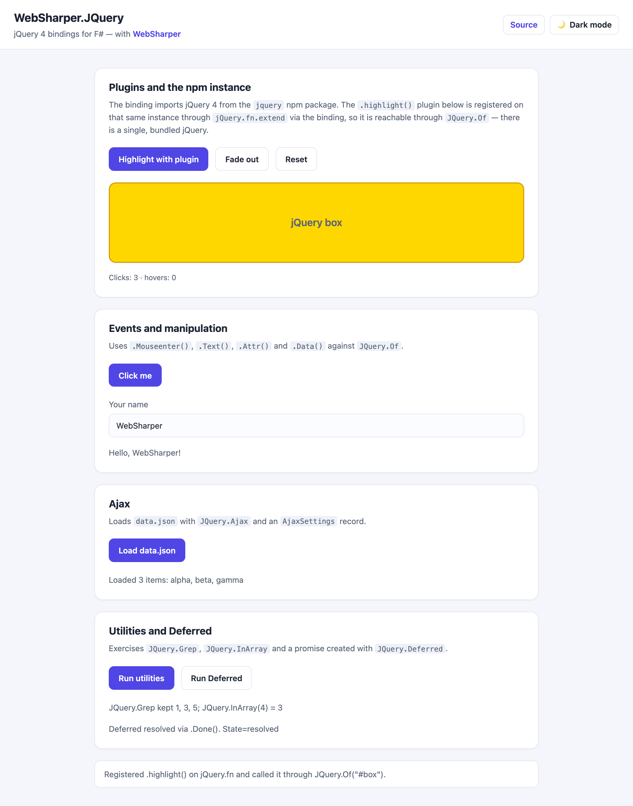

# WebSharper.JQuery

[](https://www.nuget.org/packages/WebSharper.JQuery)

WebSharper bindings for [jQuery](https://jquery.com/) 4.0 — the npm package,
bundled by your WebSharper application — for F# and C# web apps, plus
`Router.AjaxWith` helpers for driving sitelet routers from jQuery Ajax calls.

This repository contains:

| Project | Purpose |
|---|---|
| `WebSharper.JQuery` | The binding: typed wrappers for jQuery and its Ajax/Deferred/event APIs. |
| `WebSharper.JQuery.RouterExtensions` | `Router.AjaxWith`, a helper to call WebSharper endpoint routers over jQuery Ajax. |
| `WebSharper.JQuery.Sample` | A runnable WebSharper SPA demonstrating the binding, plugins and a theme switcher. |

Both assemblies ship in the single `WebSharper.JQuery` NuGet package.

## Live demos

**Try it live:** [Open the sample in your browser](https://dotnet-websharper.github.io/jquery/)



The sample doubles as the binding's [test case](#running-the-test-case): it
registers a jQuery plugin on the bundled instance, runs CSS effects, event
handlers, `Attr`/`Data`, Ajax, `Grep`/`InArray` utilities and a `Deferred`, and
switches between light and dark themes.

- **Binding sample (this repo):** https://dotnet-websharper.github.io/jquery/
- **WebSharper:** https://websharper.com

## One bundled jQuery instance

The binding imports jQuery from the **`jquery` npm package**:

```fsharp
let JQ =
    Class "jQuery"
    |> ImportDefault "jquery"
```

There is no CDN `<script>` and no global `jQuery`. Your bundler (esbuild in the
sample) bundles one copy of the package, and that same copy backs every
`JQuery.Of(...)` call and every plugin registered on `jQuery.fn`. The sample
registers `.highlight()` on that instance and then invokes it through
`JQuery.Of "#box"`, proving the two share the same jQuery.

This replaces the older global/CDN arrangement, which could end up with two
separate jQuery instances (npm inside the bundle plus a CDN script on the page)
whenever a plugin binding loaded jQuery itself.

## Install

```bash
dotnet add package WebSharper.JQuery
```

Or with Paket:

```fsharp
nuget WebSharper.JQuery
```

The binding targets `netstandard2.0` and works with WebSharper 11 projects.

The binding declares its npm dependency as
`jquery >= 4.0.0 < 5.0.0`, so your application's package manager installs a
compatible jQuery 4.x release automatically.

## Usage

```fsharp
open WebSharper
open WebSharper.JavaScript
open WebSharper.JQuery

[<JavaScript>]
let Demo () =
    // JQuery.Of builds on the bundled npm jQuery.
    JQuery.Of "#box"
        .Css("background", "gold")
        .FadeOut(600)
    |> ignore

    JQuery.Of "#go".Click(fun _ _ ->
        JS.Window.Alert("clicked"))
    |> ignore
```

Because the instance is bundled, a plugin you register on `jQuery.fn` is
visible to `JQuery.Of`:

```fsharp
[<Inline "$0.extend({ highlight: function () { return $1().css('background', 'gold'); } })">]
let private registerHighlight (fn: obj) (box: unit -> JQuery) : obj = X<obj>

[<Inline "$0.highlight()">]
let private highlight (jq: JQuery) : JQuery = X<JQuery>

registerHighlight JQuery.Fn (fun () -> JQuery.Of "#box") |> ignore
highlight (JQuery.Of "#box") |> ignore
```

The sample does exactly this and reports whether the plugin was reachable
through `JQuery.Of`.

### Ajax with sitelet routers

```fsharp
open WebSharper.JQuery
open WebSharper.JQuery.RouterExtensions

// POST the endpoint payload and await the textual response.
let! response = Router.AjaxWith (AjaxSettings(Url = "")) router Endpoint
```

## Notes on the API

- The binding is npm-based: jQuery comes from the `jquery` package and is
  included by your bundle. You do not need a `<script>` tag.
- `JQuery.Of` and the `JQuery` constructors compile to calls on the imported
  instance.
- The binding surfaces the familiar jQuery surface: events (`Click`, `On`,
  `Hover`, ...), effects (`FadeOut`, `Animate`, `Show`, `Hide`, ...), DOM
  manipulation (`Css`, `Text`, `Append`, `Find`, ...), Ajax (`Ajax`, `Get`,
  `Post`, ...) and `Deferred`/`Promise`/`Callbacks`.
- **jQuery 4 removed** several long-deprecated utilities that earlier binding
  versions exposed: `$.isArray`, `$.isFunction`, `$.isNumeric`, `$.isWindow`,
  `$.now`, `$.parseJSON`, `$.trim`, `$.type`, `$.unique`, `$.fx.interval` and
  `.size()`. They are gone from this binding; use the native
  `Array.isArray`, `JSON.parse`, `String.prototype.trim`, `Date.now`,
  `jQuery.uniqueSort` and `.length` instead.
- `.bind()`, `.unbind()`, `.delegate()` and `.undelegate()` still exist in
  jQuery 4.0.0 but remain marked `Obsolete`; prefer `.On()`/`.Off()`.

## Repository layout

```
WebSharper.JQuery/                # the binding
  Main.fs                         # jQuery types and [<assembly: Extension>] registration
WebSharper.JQuery.RouterExtensions/
  RouterExtensions.fs             # Router.AjaxWith
WebSharper.JQuery.Sample/         # SPA sample
  Client.fs
  index.html                      # template (ws-onclick / ws-var / text holes)
  data.json                       # Ajax payload
  esbuild.config.mjs
nuget/                            # Paket pack template
.github/workflows/ghpages.yml     # build + deploy sample to gh-pages
docs/sample.png                   # sample screenshot
```

## Build from source

### Prerequisites

- [.NET SDK](https://dotnet.microsoft.com/download) 11 (preview) — the
  WebSharper 11 compiler needs the .NET 11 runtime.
- [Node.js](https://nodejs.org/) (LTS) for the esbuild bundle step.
- [Paket](https://fsprojects.github.io/Paket/) as a local dotnet tool (already
  configured in `.config/dotnet-tools.json`).

### Restore and build

```bash
dotnet tool restore
dotnet paket restore
dotnet build WebSharper.JQuery.sln -c Release
```

### Running the test case

The sample is a static WebSharper SPA. Building it in Release produces the
self-contained site in `dist/`:

```bash
dotnet build WebSharper.JQuery.Sample/WebSharper.JQuery.Sample.fsproj -c Release
dotnet serve -d dist -p 8080
```

Then open <http://localhost:8080/>. Install `dotnet-serve` once with
`dotnet tool install -g dotnet-serve`.

The page exercises the plugin prototype, events, DOM manipulation, effects,
Ajax and Deferred APIs, and includes a light/dark theme switcher.

### Pack the NuGet package

```bash
WSPackageFolder=/tmp/pkg dotnet fsi ./build.fsx -t WS-Package
```

The resulting `.nupkg` contains `WebSharper.JQuery.dll` and
`WebSharper.JQuery.RouterExtensions.dll` under `lib/netstandard2.0`, plus the
binding source and WebSharper metadata.

### Deployment

Pushing to `master` triggers `.github/workflows/ghpages.yml`, which restores via
Paket, builds the sample in Release and publishes `dist/` to the `gh-pages`
branch via GitHub Pages.

## License

Apache 2.0 — see [LICENSE.md](LICENSE.md).
