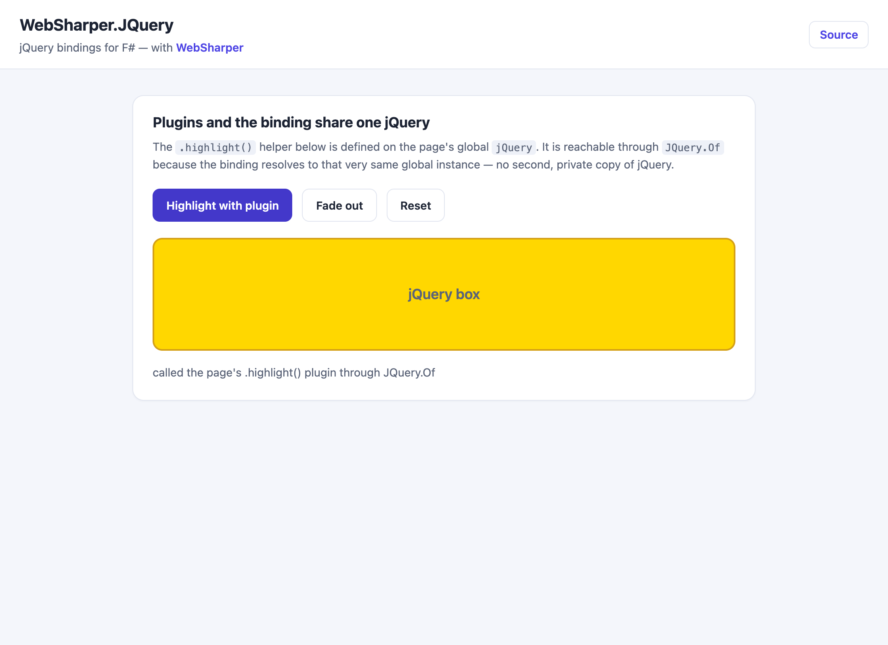

# WebSharper.JQuery

[](https://www.nuget.org/packages/WebSharper.JQuery)

WebSharper bindings for [jQuery](https://jquery.com/) 3.7+ for F# and C# web apps,
plus `Router.AjaxWith` helpers for driving sitelet routers from jQuery Ajax calls.

This repository contains:

| Project | Purpose |
|---|---|
| `WebSharper.JQuery` | The binding: typed wrappers for jQuery and its Ajax/Deferred/event APIs. |
| `WebSharper.JQuery.RouterExtensions` | `Router.AjaxWith`, a helper to call WebSharper endpoint routers over jQuery Ajax. |
| `WebSharper.JQuery.Sample` | A runnable WebSharper 10 SPA demonstrating the binding and jQuery plugins. |

Both assemblies ship in the single `WebSharper.JQuery` NuGet package.

## Live demos

- **Binding sample (this repo):** https://dotnet-websharper.github.io/jquery/
- **WebSharper:** https://websharper.com



## One jQuery instance

The binding resolves to the **global `jQuery`** that its `Resources.JQuery`
resource loads (from the jQuery CDN), and that resource is linked automatically
whenever any jQuery type is used. There is therefore a single jQuery instance,
so plugins that extend the global `$` (for example `$.fn.highcharts` from
WebSharper.Highcharts, or any plain jQuery plugin) are visible on
`JQuery.Of(...)`.

This fixes the previous behaviour, where the binding imported the npm `jquery`
module while the page also loaded jQuery from a CDN, producing **two** separate
jQuery instances: plugins attached to the global one were invisible to
`JQuery.Of`.

## Install

```bash
dotnet add package WebSharper.JQuery
```

Or with Paket:

```fsharp
nuget WebSharper.JQuery
```

The package targets `netstandard2.0` and works with any WebSharper 10 project.

## Usage

```fsharp
open WebSharper
open WebSharper.JavaScript
open WebSharper.JQuery

[<JavaScript>]
let Demo () =
    // JQuery.Of uses the global jQuery instance.
    JQuery.Of "#box"
        .Css("background", "gold")
        .FadeOut(600)
    |> ignore

    JQuery.Of "#go".Click(fun _ _ ->
        JS.Window.Alert("clicked"))
    |> ignore
```

Because the binding uses the global instance, a plugin defined on the page works
through the binding too:

```html
<script>
    jQuery.fn.highlight = function () {
        return this.css('background', 'gold');
    };
</script>
```

```fsharp
[<Inline "$j.highlight()">]
let highlight (j: JQuery) : JQuery = X<JQuery>

[<JavaScript>]
let HighlightBox () =
    highlight (JQuery.Of "#box") |> ignore
```

The sample in `WebSharper.JQuery.Sample` does exactly this and reports whether
the plugin was reachable through `JQuery.Of`.

### Ajax with sitelet routers

```fsharp
open WebSharper.JQuery
open WebSharper.JQuery.RouterExtensions

// POST the endpoint payload and await the textual response.
let! response = Router.AjaxWith (AjaxSettings(Url = "")) router Endpoint
```

## Notes on the API

- The jQuery script is declared as an `AssemblyWide` resource (`Resources.JQuery`)
  and is linked into the page automatically when you use any type from the
  binding. You do not need to add a `<script>` tag yourself.
- `JQuery.Of` and the `JQuery` constructors compile to plain `jQuery(...)` calls
  against the global instance.
- The binding surfaces the familiar jQuery surface: events (`Click`, `On`,
  `Hover`, ...), effects (`FadeOut`, `Animate`, `Show`, `Hide`, ...), DOM
  manipulation (`Css`, `Text`, `Append`, `Find`, ...), Ajax (`Ajax`, `Get`,
  `Post`, ...) and `Deferred`/`Promise`/`Callbacks`.

## Build from source

### Prerequisites

- [.NET SDK](https://dotnet.microsoft.com/download) 9.0 or later.
- [Node.js](https://nodejs.org/) (LTS) for the esbuild bundle step.
- [Paket](https://fsprojects.github.io/Paket/) as a local dotnet tool (already
  configured in `.config/dotnet-tools.json`).

### Restore and build

```bash
dotnet tool restore
dotnet tool run paket restore
dotnet build WebSharper.JQuery.sln -c Release
```

### Run the sample

The sample is a static WebSharper 10 SPA. Building it in Release produces the
self-contained site in `dist/`:

```bash
cd WebSharper.JQuery.Sample
dotnet build -c Release
# then serve the generated site, e.g.
npx serve ../dist
```

### Pack the NuGet package

After a Release build (so the assemblies exist in `bin/Release/netstandard2.0`):

```bash
dotnet tool run paket pack ./out
```

The resulting `.nupkg` contains `WebSharper.JQuery.dll` and
`WebSharper.JQuery.RouterExtensions.dll` under `lib/netstandard2.0`, plus the
binding source.

### Deployment

Pushing to `master` triggers `.github/workflows/ghpages.yml`, which builds the
sample in Release and publishes `dist/` to the `gh-pages` branch via GitHub Pages.

## Repository layout

```
WebSharper.JQuery/                # the binding
  Main.fs                         # jQuery types and [<assembly: Extension>] registration
WebSharper.JQuery.RouterExtensions/
  RouterExtensions.fs             # Router.AjaxWith
WebSharper.JQuery.Sample/         # WS10 SPA sample
  Client.fs
  index.html                      # template (ws-onclick / text holes)
  esbuild.config.mjs
nuget/                            # Paket pack template
.github/workflows/ghpages.yml     # build + deploy sample to gh-pages
```

## License

Apache 2.0 — see [LICENSE.md](LICENSE.md).
